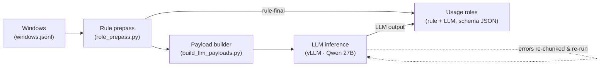

# PMC Identifier Usage-Role Classification — Recovery and Gold-Standard Evaluation

_As of 2026-10-27._

## Executive summary

This pipeline reads PubMed Central full text and classifies, for every database
identifier it finds, how the paper relates to that record: the paper
**generated** it (deposited its own data), **used** it (took a pre-existing
record or material as input), or merely **mentioned** it. The distinction is
what separates data-deposition credit from data-reuse credit in data-usage
metrics.

Against a 221-item expert gold standard, the current pipeline reaches
**macro-F1 0.913 and accuracy 0.916** on the 203 scored items (the 18 "unsure"
gold items are reported separately, not scored). Per class: generated F1 0.912,
used F1 0.931, mentioned F1 0.896.

All **53,660 identifier mentions across 14,702 articles** are classified, with
**zero** unresolved records. Two lines of work produced this: a robustness fix
that eliminated context-overflow failures on dense accession lists (4,169
failures recovered to 0), and a rubric/rule refinement that raised macro-F1 from
0.854 to 0.909, concentrated on the sequence-database classes that were
previously weakest. A subsequent single-label gold correction (an annotator
commit omission, MGI:2389228 mentioned→used) brings the final figure to 0.913
(accuracy 0.916).

## Background and task

This work measures how deposited datasets are reused in
the literature by extracting database identifiers from PMC full text and
determining each one's role in the paper. A raw mention count conflates three
very different events, so each identifier occurrence is assigned exactly one
role:

- **generated** — this study produced the record and deposited or registered it
  (Data Availability / Accession Numbers sections; "deposited", "we sequenced",
  "has been deposited"). Credit goes to this paper's authors.
- **used** — a pre-existing dataset, reference resource, or biological material
  is taken as input or material for this study: downloaded/obtained/reanalysed
  data, a reference genome aligned against, a sequence used to design
  primers/probes/siRNA or to build a construct, or a strain/cell line obtained
  and used. Credit goes to the original depositor.
- **mentioned** — the identifier only names or cites an entity, with no use of
  its sequence/data in this paper's own experiments.

For identifiers.org this matters directly: the same accession reconciled through
the registry carries a different meaning for provenance and attribution
depending on whether a citing paper deposited it, reused it, or only named it.
The role is the signal that turns an identifier co-occurrence into an
attributable reuse event.

## Pipeline architecture

The rule prepass resolves the clear cases outright; everything ambiguous is
batched by the payload builder into token-budgeted chunks sharing one cached
rubric, classified by a locally served model under a JSON schema, and merged
with the rule rows into one usage-roles table. Transient LLM errors are
re-chunked and re-run until none remain.

## Robustness and failure recovery

The first full run left 4,169 identifiers (across 245 articles) unclassified.
All failures were on the LLM path and concentrated on articles with dense
accession lists (RefSeq RNA/protein, FlyBase, Ensembl, TAIR, GEO). The cause was
that batching by a fixed entity count ignored density: a chunk of 15
accession-heavy windows overran the model's 16,384-token context, and the whole
chunk returned an error.

Three failure modes were separated from the error logs and fixed at the source
rather than by retry alone:

- **Context overflow (HTTP 400)** — chunking now packs by a token budget
  (estimated at the empirical ~1.3 characters/token of accession text) instead
  of a fixed entity count.
- **Output truncation (malformed JSON)** — the per-request output budget is
  sized from the number of entities, so schema-constrained generation is not cut
  off mid-object.
- **Timeouts** — lower concurrency plus smaller requests; a multi-line
  window-truncation bug (only the first line of a window was being trimmed) was
  the dominant hidden cause and was corrected.

A targeted recovery re-processed only the failed records with density-aware
chunking, bringing 4,169 → 0. The fixes were then folded into the payload
builder, so the rebuilt end-to-end run produced only 97 transient errors out of
45,146 LLM calls (0.2%), themselves recovered to 0. The final table has no error
or missing rows.

## Evaluation methodology

The gold standard holds 221 expert-annotated identifier occurrences: mentioned
66, used 102, generated 35, and unsure 18. Predictions are joined to gold on the
exact key (doc_id, dataset, id); all 221 matched, none dropped.

Scoring runs on the 203 items whose gold label is one of the three target
classes. The 18 "unsure" items are excluded from precision/recall and reported
separately, so accuracy is not depressed by items experts themselves could not
call. Macro-F1 is averaged over the classes present in each stratum, so a rule
subset that only ever emits two classes is not penalised for a third with no
support.

The headline metric is macro-F1 (unweighted mean of per-class F1), chosen over
accuracy because the classes are imbalanced (used and mentioned dominate,
generated is rare) and each class matters for attribution.

One caveat is stated plainly: the rubric and rules were refined while inspecting
disagreements on this same gold set, so it functions as a development set. With
no held-out set yet, 0.913 is an optimistic estimate of generalisation; an
independent validation set is the natural next step.

## Results

On the 203 scored items, macro-F1 is 0.913 (accuracy 0.916); the pipeline is
strongest on used (F1 0.931) and generated (0.912), with mentioned at 0.896.

| Class     | Precision | Recall | F1    | Support |
| --------- | --------- | ------ | ----- | ------- |
| generated | 0.939     | 0.886  | 0.912 | 35      |
| used      | 0.931     | 0.931  | 0.931 | 102     |
| mentioned | 0.882     | 0.909  | 0.896 | 66      |
| **Overall** |         |        | **0.913** (macro) | 203 |

Confusion matrix (gold in rows, prediction in columns):

| gold ↓ / pred → | generated | used | mentioned |
| --------------- | --------- | ---- | --------- |
| generated       | 31        | 1    | 3         |
| used            | 2         | 95   | 5         |
| mentioned       | 0         | 6    | 60        |

By source — the rule prepass is small but exact; the LLM carries the bulk:

| Source       | n   | Accuracy | Macro-F1 |
| ------------ | --- | -------- | -------- |
| Rule prepass | 26  | 1.000    | 1.000    |
| LLM          | 177 | 0.904    | 0.901    |

By dataset (n ≥ 10):

| Dataset        | n  | Accuracy | Macro-F1 |
| -------------- | -- | -------- | -------- |
| RefSeq protein | 21 | 0.952    | 0.978    |
| RefSeq RNA     | 51 | 0.922    | 0.927    |
| miRBase        | 15 | 0.933    | 0.919    |
| GEO series     | 58 | 0.914    | 0.898    |
| RefSeq genomic | 20 | 0.900    | 0.868    |
| ChEBI          | 10 | 1.000    | 1.000\*  |

\*ChEBI gold is single-class (all mentioned), so its macro-F1 is trivially 1.0.
On the 18 unsure gold items (reported separately), the pipeline predicted
mentioned 15, used 2, generated 1.

## Error analysis and rubric refinement

Error analysis on the first evaluation (macro-F1 0.854) found one systematic
error: 22 of the disagreements were used → mentioned, almost all the same
pattern — a gene/transcript named with a parenthetical accession whose sequence
the paper actually uses as material ("GAPDH (NM_204305) ggagtcaac..." as a
primer; "siRNAs targeting c-Met (accession no. NM_000245)"). The model read the
parenthetical form as naming and returned mentioned.

Two targeted changes followed:

- **Rubric (used/mentioned boundary).** The used definition now states that an
  accession whose sequence is consumed as experimental material — primers,
  probes, siRNA/shRNA, cloning, or a mutation/variant reference — is used even
  when written parenthetically; and that obtaining a strain/cell line/clone by
  its registry ID and using it is used. The mentioned definition was tightened to
  naming, annotation statements ("X (NM_...) lacks an intron"), and
  cross-reference pointers ("described in GEO sample GSM..."). Contrastive
  examples were added.
- **Rule prepass.** A reference-use regular expression was firing on the literal
  phrase "reference sequence" — the RefSeq database name ("NCBI Reference
  Sequence", "reference sequence numbers") — and wrongly marking named RefSeq
  proteins as used. That database-name false positive was removed; genuine
  reference use (aligned/mapped to, compared to an accession) is still caught.

The net effect was macro-F1 0.854 → 0.909 and used recall 0.772 → 0.931, with
the previously weak sequence databases improving most: RefSeq protein 0.83 →
0.98, RefSeq RNA 0.78 → 0.93, miRBase 0.73 → 0.92. The cost was small and
expected — mentioned → used ticked from 4 to 7 (6 after the gold correction), and generated F1 softened
slightly (0.925 → 0.912) — both far outweighed by the used gain.

## Limitations and next steps

- **No held-out set.** The rubric was tuned on the gold set, so 0.913 is a
  development-set figure. A separate, independently annotated validation set is
  needed to confirm generalisation; until then the number should be cited as
  such.
- **Residual confusions.** The remaining errors are small and partly reflect
  genuine annotation ambiguity: generated vs used on GEO deposition statements
  (whether data available at a GEO series was produced here or reused), and a
  handful of mentioned/used boundary cases. These are not worth further rubric
  tuning against 221 items, which would risk overfitting.
- **"unsure" behaviour.** On the 18 unsure gold items the pipeline leans
  mentioned (15 of 18); worth a brief look with annotators to confirm that is the
  desired default.
- **Scale-up.** This evaluation covers one PMC shard (pmc000). The hardened
  payload builder and prepass are ready to run across the full corpus with the
  same settings.

Useful next steps with identifiers.org: validate the role labels against
registry-reconciled identifiers, and agree conventions for the ambiguous cases
above (deposition-vs-reuse language, physical-material acquisition) so that reuse
events feed cleanly into provenance and attribution metadata.

---

_Reproduction: roles are produced by `role_prepass.py` → `build_llm_payloads.py`
→ `role_llm_run.py` (`--json-mode schema`) and scored against
`data/gold_standard.md` with `eval_roles.py`. Figures above are from the pmc000
shard; metrics computed on the 203 scored gold items._
