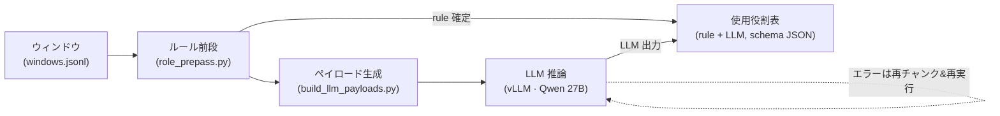

# PMC 識別子の使用役割分類 — 障害回収とゴールド評価

_2026-10-14 時点。_

## 要約

本パイプラインは PubMed Central の全文を読み、見つかった各データベース識別子について、
その論文が当該レコードとどう関わるかを分類する。すなわち、論文がそれを **generated**
（自らのデータを寄託した）、**used**（既存のレコードや材料を入力として使った）、あるいは単に
**mentioned**（言及しただけ）のいずれかである。この区別が、データ利用メトリクスにおける
「寄託の功績」と「再利用の功績」を分ける。

221 件の専門家によるゴールドスタンダードに対し、現行パイプラインはスコア対象 203 件で
**macro-F1 0.909・accuracy 0.911** に達する（18 件の "unsure" はスコア対象外として別掲）。
クラス別では generated F1 0.912、used F1 0.926、mentioned F1 0.889。

**14,702 論文にわたる 53,660 件の識別子言及**すべてが分類され、未解決レコードは **ゼロ**。
これを実現したのは 2 つの作業である。密なアクセッション列で起きていたコンテキスト超過の
障害を解消したロバスト性修正（4,169 件の失敗を 0 に回収）と、macro-F1 を 0.854 から 0.909 へ
引き上げたルーブリック/ルールの改修（従来もっとも弱かった配列データベース系のクラスに集中）。

## 背景とタスク

本作業は SPReAD の一部であり、寄託されたデータセットが文献でどう再利用されたかを、PMC 全文から
データベース識別子を抽出し各々の論文内での役割を判定することで測る。単純な言及数は 3 つの
まったく異なる事象を混同するため、各識別子の出現に対してちょうど 1 つの役割を割り当てる。

- **generated** — この研究がレコードを産生し、寄託・登録した（Data Availability / Accession
  Numbers 節、「deposited」「we sequenced」「has been deposited」など）。功績はこの論文の著者に帰す。
- **used** — 既存のデータセット・参照資源・生物材料を、この研究の入力または材料として用いた。
  ダウンロード/取得/再解析したデータ、アラインメント先の参照ゲノム、プライマー/プローブ/siRNA の
  設計やコンストラクト構築に使った配列、入手して使った系統・細胞株など。功績は元の寄託者に帰す。
- **mentioned** — 識別子は実体を命名・引用しているだけで、この論文自身の実験でその配列/データを
  使っていない。

identifiers.org にとってこれは直接的に重要である。レジストリで名寄せされた同一アクセッションでも、
引用論文がそれを寄託したのか、再利用したのか、単に名を挙げただけなのかによって、来歴と帰属の
意味が変わる。役割こそが、識別子の共起を帰属可能な再利用イベントへと変える信号である。

## パイプライン構成

ルール前段が明快なケースを即決し、曖昧なものはすべてペイロード生成器がトークン予算ベースの
チャンクへ束ね（1 つのキャッシュ済みルーブリックを共有）、ローカルで提供するモデルが JSON
スキーマ制約下で分類し、ルール行と統合して 1 つの使用役割表にまとめる。LLM の一過性エラーは
残りが無くなるまで再チャンク・再実行される。

## ロバスト性と障害回収

最初の全体実行では 4,169 件の識別子（245 論文）が未分類で残った。失敗はすべて LLM 経路で、
密なアクセッション列を持つ論文（RefSeq RNA/protein、FlyBase、Ensembl、TAIR、GEO）に集中して
いた。原因は、固定エンティティ件数でのバッチ化が密度を無視していたことにある。アクセッションの
多いウィンドウ 15 件のチャンクがモデルの 16,384 トークンのコンテキストを超過し、チャンク全体が
エラーになっていた。

エラーログから 3 つの失敗モードを切り分け、リトライだけでなく元から修正した。

- **コンテキスト超過（HTTP 400）** — チャンク化を固定件数ではなくトークン予算で詰めるように変更
  （アクセッション文の実測値である約 1.3 文字/トークンで見積もる）。
- **出力の途切れ（不正 JSON）** — リクエストごとの出力予算をエンティティ数から算定し、スキーマ
  制約生成が途中で切れないようにした。
- **タイムアウト** — 並列度を下げ、リクエストを小さくした。隠れた主因だった複数行ウィンドウの
  切り詰めバグ（ウィンドウの先頭行しか切られていなかった）を修正した。

対象を絞った回収で、失敗レコードだけを密度対応チャンクで再処理し、4,169 → 0 とした。その後、
修正をペイロード生成器に取り込んだため、再構築した端から端までの実行では 45,146 回の LLM 呼び出し
中わずか 97 件（0.2%）の一過性エラーにとどまり、それも 0 に回収した。最終表に error・missing 行は
ない。

## 評価方法

ゴールドスタンダードは専門家が注釈した 221 件の識別子出現から成る（mentioned 67、used 101、
generated 35、unsure 18）。予測は (doc_id, dataset, id) の完全一致キーでゴールドに結合し、221 件
すべてが一致、脱落なし。

スコアはゴールドラベルが 3 つの対象クラスのいずれかである 203 件で算出する。18 件の "unsure" は
precision/recall から除外し別掲するので、専門家自身が判定できなかった項目で accuracy が押し
下げられない。macro-F1 は各層に存在するクラスだけで平均するため、2 クラスしか出さないルール
サブセットが、支持数ゼロの 3 つ目のクラスで不当に減点されることはない。

主指標は macro-F1（クラス別 F1 の非加重平均）とした。クラスが不均衡（used と mentioned が多数、
generated は稀）で、かつ帰属にはどのクラスも重要なので、accuracy より適切である。

明確に述べておく注意点が 1 つある。ルーブリックとルールは、この同じゴールド集合での不一致を
精査しながら改修したため、これは開発セットとして機能している。まだ held-out 集合が無いため、
0.909 は汎化性能の楽観的な推定値であり、独立した検証セットが次の自然な一歩である。

## 結果

スコア対象 203 件で macro-F1 は 0.909（accuracy 0.911）。used（F1 0.926）と generated（0.912）が
もっとも強く、mentioned は 0.889。

| クラス    | Precision | Recall | F1    | 支持数 |
| --------- | --------- | ------ | ----- | ------ |
| generated | 0.939     | 0.886  | 0.912 | 35     |
| used      | 0.922     | 0.931  | 0.926 | 101    |
| mentioned | 0.882     | 0.896  | 0.889 | 67     |
| **全体**  |           |        | **0.909**（macro） | 203 |

混同行列（行=ゴールド、列=予測）:

| ゴールド ↓ / 予測 → | generated | used | mentioned |
| ------------------- | --------- | ---- | --------- |
| generated           | 31        | 1    | 3         |
| used                | 2         | 94   | 5         |
| mentioned           | 0         | 7    | 60        |

経路別 — ルール前段は小規模だが完全、LLM が大半を担う:

| 経路         | n   | Accuracy | Macro-F1 |
| ------------ | --- | -------- | -------- |
| ルール前段   | 26  | 1.000    | 1.000    |
| LLM          | 177 | 0.898    | 0.896    |

データセット別（n ≥ 10）:

| データセット   | n  | Accuracy | Macro-F1 |
| -------------- | -- | -------- | -------- |
| RefSeq protein | 21 | 0.952    | 0.978    |
| RefSeq RNA     | 51 | 0.922    | 0.927    |
| miRBase        | 15 | 0.933    | 0.919    |
| GEO series     | 58 | 0.914    | 0.898    |
| RefSeq genomic | 20 | 0.900    | 0.868    |
| ChEBI          | 10 | 1.000    | 1.000\*  |

\*ChEBI のゴールドは単一クラス（すべて mentioned）なので、macro-F1 は自明に 1.0。18 件の unsure
（別掲）では、パイプラインは mentioned 15、used 2、generated 1 と予測した。

## 誤り分析とルーブリック改修

最初の評価（macro-F1 0.854）での誤り分析から、系統的な誤りが 1 つ見つかった。不一致 22 件が
used → mentioned で、ほぼ同一のパターンだった。すなわち、括弧付きアクセッションで命名された
遺伝子/転写産物で、その配列を論文が実際に材料として使っているもの（プライマーとしての「GAPDH
(NM_204305) ggagtcaac...」、「siRNAs targeting c-Met (accession no. NM_000245)」）。モデルは
括弧書きの形を命名と読み、mentioned を返していた。

対象を絞った 2 つの変更を行った。

- **ルーブリック（used/mentioned の境界）。** used の定義に、配列を実験材料として使う
  アクセッション — プライマー、プローブ、siRNA/shRNA、クローニング、変異/多型の参照 — は、
  括弧書きであっても used であること、および系統/細胞株/クローンをレジストリ ID で入手して使うのも
  used であることを明記した。mentioned の定義は、命名・注釈的記述（「X (NM_...) にはイントロンが
  ない」）・参照ポインタ（「GEO sample GSM... に記載」）に締めた。対比例も追加した。
- **ルール前段。** 参照使用の正規表現が、文字列「reference sequence」— RefSeq データベース名
  （「NCBI Reference Sequence」「reference sequence numbers」）— に発火し、命名された RefSeq
  タンパク質を誤って used にしていた。このデータベース名による誤検出を除去した。真の参照使用
  （aligned/mapped to、compared to an accession）は引き続き捕捉される。

正味の効果は macro-F1 0.854 → 0.909、used recall 0.772 → 0.931 で、従来弱かった配列データベースが
もっとも改善した（RefSeq protein 0.83 → 0.98、RefSeq RNA 0.78 → 0.93、miRBase 0.73 → 0.92）。
代償は小さく想定内で、mentioned → used が 4 → 7 に増え、generated F1 がわずかに軟化した
（0.925 → 0.912）が、いずれも used の改善が大きく上回る。

## 限界と次の一歩

- **held-out 集合が無い。** ルーブリックはこのゴールドで調整したため、0.909 は開発セット上の値で
  ある。汎化を確認するには独立に注釈した検証セットが必要で、それまではこの数値をそのように明記
  して引用すべきである。
- **残存する混同。** 残る誤りは小さく、一部は真の注釈の曖昧さを反映する。GEO の寄託表現における
  generated 対 used（GEO series で入手可能なデータをここで産生したのか再利用したのか）、および
  mentioned/used の境界事例が少数。221 件に対しこれ以上ルーブリックを追い込むのは過学習の恐れが
  あり、割に合わない。
- **"unsure" の挙動。** 18 件の unsure では、パイプラインは mentioned に寄る（18 件中 15 件）。
  それが望ましい既定か、注釈者と軽く確認する価値がある。
- **スケールアップ。** 本評価は PMC の 1 シャード（pmc000）が対象。堅牢化したペイロード生成器と
  前段は、同じ設定で全コーパスに実行できる状態にある。

identifiers.org との有用な次の一歩: 役割ラベルをレジストリで名寄せした識別子に対して検証し、
上記の曖昧な事例（寄託対再利用の表現、物理材料の入手）について規約を合意して、再利用イベントが
来歴・帰属メタデータへ綺麗に流れ込むようにすること。

---

_再現手順: 役割は `role_prepass.py` → `build_llm_payloads.py` → `role_llm_run.py`
（`--json-mode schema`）で生成し、`data/gold_standard.md` に対して `eval_roles.py` でスコアする。
上記の数値は pmc000 シャードのもので、スコア対象のゴールド 203 件で算出した。_
